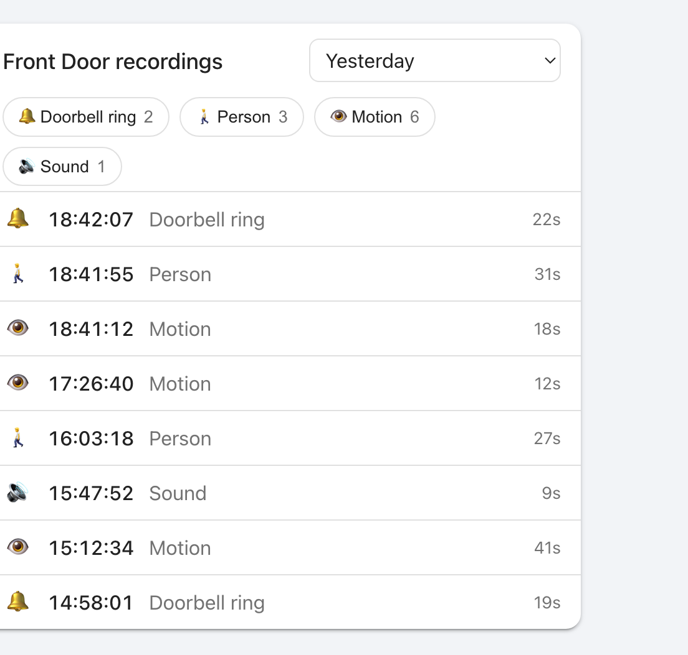
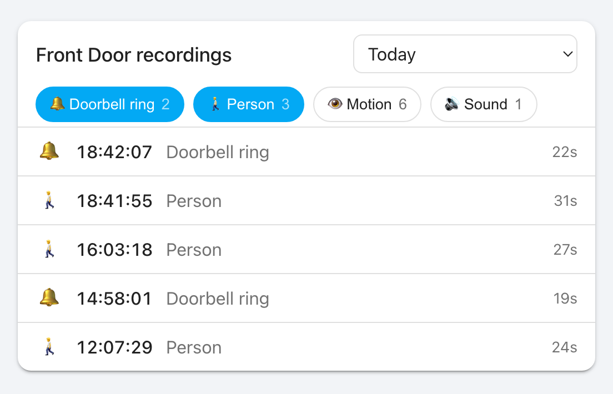
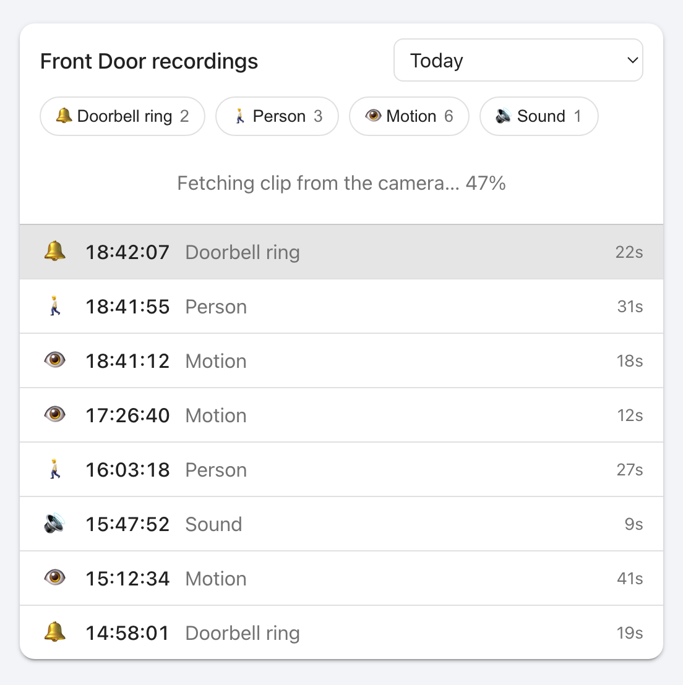
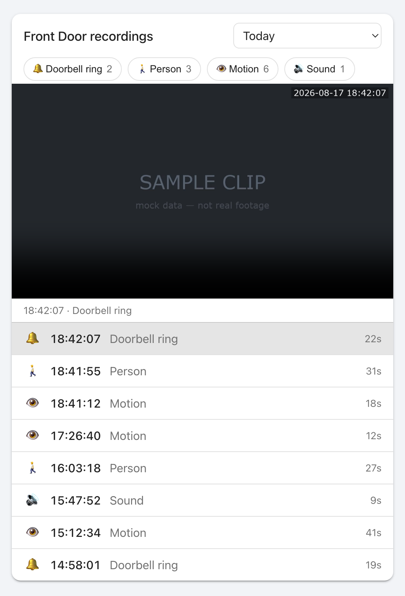
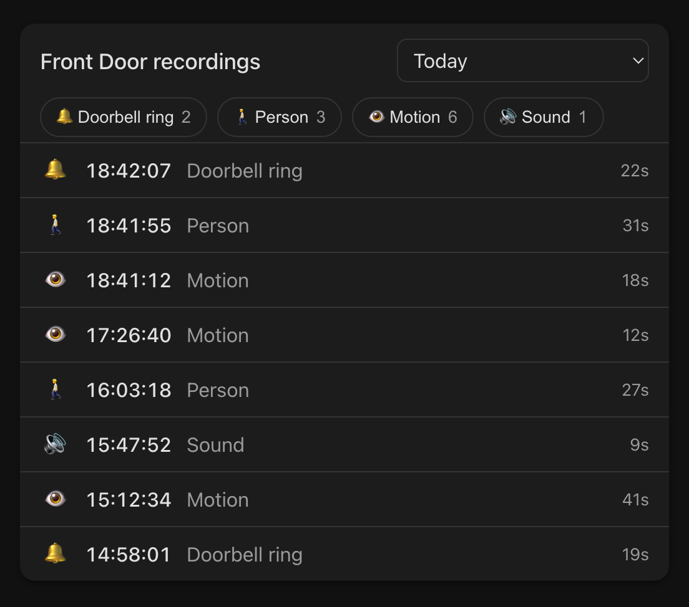

# Kasa Doorbell (local)

A Home Assistant custom integration for the **TP-Link Kasa KD110 video doorbell** — a device
that ships with no RTSP, no ONVIF and no documented local API, and otherwise only works through
the Kasa phone app.

**It is 100% local**, which is the whole point of it. The TP-Link cloud is never contacted, at
setup or at runtime. There is no go2rtc, no Frigate, no MQTT broker, no add-on and no binary to
install — just the ffmpeg that Home Assistant already bundles.

Everything here was developed and verified against a KD110. The protocol is shared across the
Kasa camera family and the code handles the family generically, so other Kasa cameras have a
fair chance of working — but none have been tested. See [Supported devices](#supported-devices).

<p align="center">
  
</p>

---

## What you get

| Entity | Source | Notes |
|---|---|---|
| `camera.*` | own video pipeline: device HTTPS multipart → ffmpeg → MPEG-TS → HA `stream` | live view, video only |
| `binary_sensor.*_motion` | `vod.get_detect_event_state` polled every 2 s | ~1–2 s latency, real off-state |
| `switch.*_camera_active` | `switch.set_is_enable` | the camera's privacy toggle |
| `switch.*_status_led` | `led.set_status` | |
| `switch.*_do_not_disturb` | `dndSchedule.set_dnd_enable` | |
| `sensor.*_wi_fi_signal` | sysinfo `rssi` | dBm |
| `sensor.*_resolution` | sysinfo `resolution` | |
| `sensor.*_battery` | `battery.get_status` | battery models only |
| **Recordings card** | the camera's own SD card | a custom Lovelace card, see below |

Every switch and sensor is **capability-gated**: the integration asks the camera which modules it
has at setup and only creates entities the device actually supports. A KD110 gets no battery
sensor and no siren switch, because it has neither.

## Requirements

- Home Assistant **2024.8** or newer
- The doorbell on the same LAN as Home Assistant, reachable by IP
- Your TP-Link / Kasa **account** email and password (see [Credentials](#credentials-and-privacy))
- An SD card in the camera, if you want recordings

## Install

### HACS (recommended)

1. HACS → ⋮ → **Custom repositories** → add this repository's URL, category **Integration**.
2. Search HACS for **Kasa Doorbell (local)**, install it, and restart Home Assistant.

### Manual

Copy `custom_components/kasa_doorbell_local/` into your Home Assistant `config/custom_components/`
directory and restart:

```bash
cp -r custom_components/kasa_doorbell_local /path/to/homeassistant/config/custom_components/
```

### Set up

**Settings → Devices & Services → Add Integration → "Kasa Doorbell (local)"**, then supply:

| Field | Value |
|---|---|
| Camera IP address | e.g. `192.168.1.50` — give the camera a DHCP reservation |
| TP-Link / Kasa account email | the account the camera is registered to |
| TP-Link / Kasa account password | your account password |
| Local secret | leave blank (advanced override, see below) |

The integration then asks the camera for its own `system.get_sysinfo` over the LAN and identifies
the model, device ID, firmware and capability set from the reply. Nothing leaves your network.

## Credentials and privacy

Kasa cameras authenticate **local** connections with your TP-Link account email and a cipher of
your account password — for the KD110, `md5(password)`. That is a device design decision, not a
choice this integration made; the camera will not answer without it.

What the integration does with it:

- Both the password and the derived secret are used **only** in requests to the camera's IP.
- The config entry stores the account password (as every HA integration with a login does) plus
  the *name* of the cipher the camera accepted — never the derived secret. The secret is
  re-derived on each start, so changing your TP-Link password fixes local access by itself
  instead of silently breaking it.
- Diagnostics downloads redact the email, password and secret.

If you would rather not store the account password at all, put the already-ciphered value in the
**Local secret** field at setup and give a throwaway string as the password. The integration will
use the override verbatim. The trade-off is that you must update it by hand if the password ever
changes.

## The recordings card

Kasa cameras with an SD card record continuously and tag each finished clip with what triggered
it. The card browses those clips: pick a day, filter by trigger, click to play.

The card is **served by the integration itself** — no Lovelace resource to register, no file to
copy into `www/`. Add a Manual card:

```yaml
type: custom:kasa-recordings-card
```

That is the whole configuration for a single camera. All options:

```yaml
type: custom:kasa-recordings-card
entity: camera.front_door      # optional — only needed with more than one Kasa camera
title: Front Door recordings   # optional — defaults to "<camera> recordings"
```

> If the card does not appear right after installing, hard-refresh the browser
> (<kbd>Cmd/Ctrl</kbd>+<kbd>Shift</kbd>+<kbd>R</kbd>). The frontend caches JS modules
> aggressively.

### Filtering

Each chip is a trigger type with its count for that day. Chips toggle; **no chips selected means
everything**, so clearing a filter is one click.

<p align="center">
  
</p>

The five trigger types the camera reports are **Doorbell ring** (`RING`), **Person** (`PD`),
**Motion** (`MD`), **Sound** (`AD`) and **Baby cry** (`BCD`). Read them as *what started this
recording* — see [the caveat below](#trigger-labels-are-not-ai-classification).

### Playing a clip

Clicking a clip does not stream it. The integration **fetches the recording into a real MP4 file
first**, the card polls until it is ready, then plays that file.

<p align="center">
  
  
</p>

This costs a few seconds up front and is worth it. The camera delivers recorded footage at about
2.5× realtime, so a 20-second clip takes roughly eight seconds to fetch. In exchange the clip
plays immediately, seeks properly, and **has sound** — none of which worked reliably while
recordings were streamed as an open-ended response. Clips are cached (LRU, 1.5 GB), so
re-watching one is instant.

The card follows your Home Assistant theme:

<p align="center">
  
</p>

> **About these screenshots:** they are the real card rendered against mock clip data, so no
> footage from a real home is shown. The layout, chips, labels and states are exactly what you
> will see.

## Limitations

These are properties of the camera, not bugs. Most of them cost real effort to discover, so they
are written down plainly.

### The camera allows exactly ONE stream connection

This is the big one. The device accepts a single video connection at a time and holds it for a
few seconds after the client leaves.

- Fetching a recording therefore **takes the slot from the live view**, which goes unavailable
  until the fetch finishes — the fetch only, not the whole time you watch the clip.
- Playback deliberately outranks live. Home Assistant retries a live stream every few seconds
  forever, so if live could evict a fetch, long clips would never finish downloading.
- Multiple people watching the live view is fine — the integration runs one pipeline per camera
  and fans it out to all viewers.
- Parallel clip fetching is impossible. Three concurrent connections were measured as one `200`
  and two `503`.

### Recordings appear 1–2 minutes late

A clip only becomes listable once the camera **finalizes** it, roughly 1–2 minutes after the
event ends (the delay tracks the clip's own length). The recordings card is for reviewing what
happened, not for watching what is happening. Use the live view and the motion sensor for that.

### No audio on the live view

Live is video-only. The camera interleaves H.264 and G.711 audio in one stream and the muxing
works, but browsers will not start playing this device's two-track live stream — they spin while
loading. Video-only starts instantly. **Recorded clips do have audio.**

### No doorbell-press sensor

The doorbell press is real and correctly typed as `RING`, but it only arrives through the clip
list, 1–2 minutes late. A "doorbell pressed" sensor that fires two minutes after someone leaves
is worse than no sensor, so there isn't one. Ring events do show up in the recordings card.

The KD110's physical chime is RF-paired directly to the button, off-network, so there is no
software-only way to detect a press in real time.

### Trigger labels are not AI classification

`alarm_type` names **what started the recording**, not what is in it. A person standing plainly
in frame is frequently logged as plain `Motion`. The labels stay literal for that reason —
"Person detected" would overclaim. TP-Link's own person detection is a cloud post-process and is
not available locally.

### Real-time push notifications are not possible

TP-Link only delivers push notifications to the account's **primary phone**. Additional
registered tokens receive nothing, verified with a working FCM registration. The motion sensor
polls the camera directly instead, which is local and fast (~1–2 s).

### Other notes

- **No PTZ, no two-way audio, no siren control.** Not implemented; the KD110 has none of them.
- **No snapshots.** `camera.snapshot` derives its image from the stream rather than opening a
  second connection, which would fight the single slot.
- **No discovery.** Cameras are added by IP, so give yours a DHCP reservation.
- **Recording history is bounded by the SD card**, which is a ring buffer — about 8 days on the
  KD110's 119 GB card. The day list reflects what the card actually still holds.

## Supported devices

| Model | Status |
|---|---|
| **KD110** | ✅ Verified — every feature in this README was developed and tested on it |
| KD310, KC1xx–KC4xx, EC6x–EC8x | ⚠️ Should work; untested. Cipher negotiation, stream-port probing and battery handling are all implemented generically |
| Tapo cameras (`TC*`, `C1xx`, `C2xx`…) | ❌ Out of scope — different protocol (KLAP). Use the [Tapo integration](https://github.com/JurajNyiri/HomeAssistant-Tapo-Control) |

If you try another Kasa model, please open an issue with the result either way. Include the
model number and, if setup failed, the `custom_components.kasa_doorbell_local` lines from your log
with debug logging on:

```yaml
logger:
  logs:
    custom_components.kasa_doorbell_local: debug
```

## How it works

```
                    ┌── :10443  Linkie JSON  ── sysinfo, capabilities, motion, clip list
Home Assistant ─────┤
                    ├── :19443  live video   ─┐
                    └── :17443  recordings   ─┴─ HTTPS multipart → ffmpeg → HA
```

**Control** is a JSON channel on port 10443 (`/data/LINKIE2.json`): the body is XOR-obfuscated
with the classic Kasa autokey cipher, over TLS with a self-signed certificate and legacy ciphers,
authenticated with HTTP Basic.

**Video** is an HTTPS `multipart/x-mixed-replace` stream that interleaves H.264 video parts and
G.711 audio parts. Home Assistant's `stream` component cannot open it (PyAV has no such protocol)
and neither can HA's bundled go2rtc, which ships without the `kasa` driver. So the integration
reads the multipart stream itself, feeds the H.264 into ffmpeg, and serves the result on loopback
for Home Assistant to consume.

**Seeking** into recordings is a query parameter (`start_time=<epoch>`) on the playback port, not
a control command.

Each module carries the details in its docstring; several ffmpeg flags are counter-intuitive and
pinned by tests, so read the comments before adjusting them.

## Development

```
custom_components/kasa_doorbell_local/
  api.py           local control channel: auth, XOR cipher, sysinfo, detections
  coordinator.py   polling, capability probing, entity state
  stream.py        multipart reader + ffmpeg pipelines (live and playback)
  view.py          HTTP views serving video on loopback
  clips.py         fetches a recording to a real MP4, LRU disk cache
  websocket.py     recordings API backing the card
  frontend.py      serves and auto-registers the card
  www/kasa-recordings-card.js    the Lovelace card, dependency-free
```

Tests stub Home Assistant, so they run without it installed:

```bash
python3 tests/test_stream.py
```

```bash
python3 tests/test_api.py
```

`test_api.py` imports `api.py`, which needs `aiohttp`. Both files also run under pytest.

## Acknowledgements

The protocol was recovered by reverse-engineering the Kasa Smart Android app and verified against
real hardware. This project is not affiliated with or endorsed by TP-Link. Kasa is a trademark of
TP-Link Technologies.

## License

[MIT](LICENSE)
